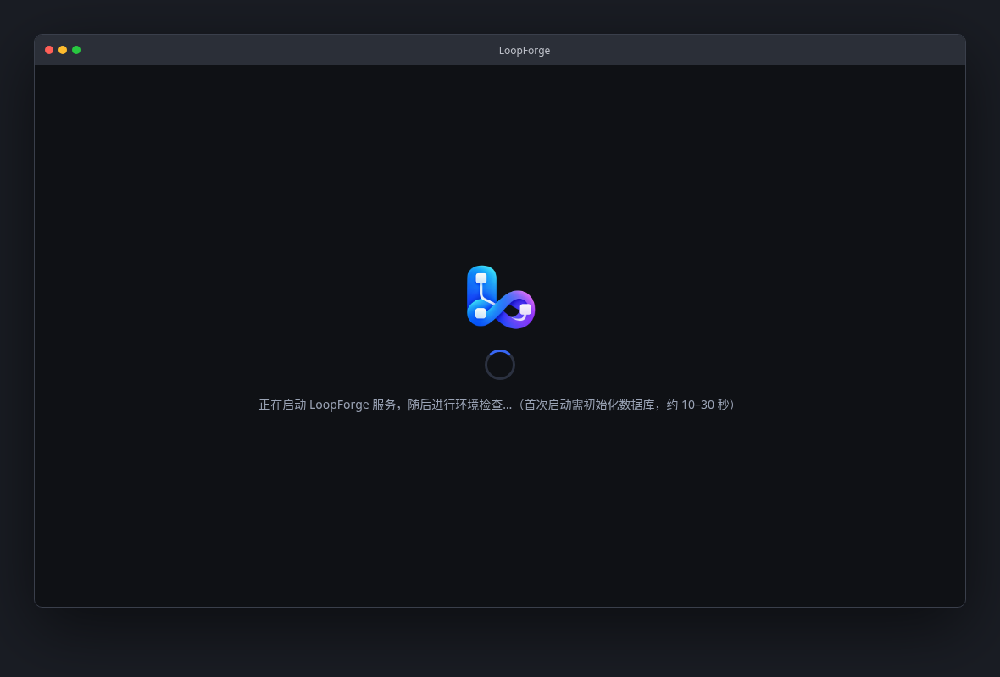
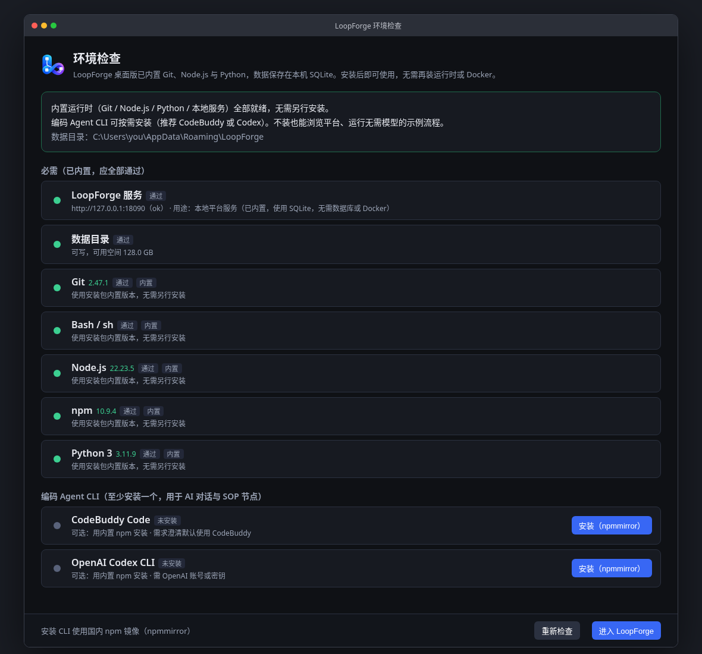
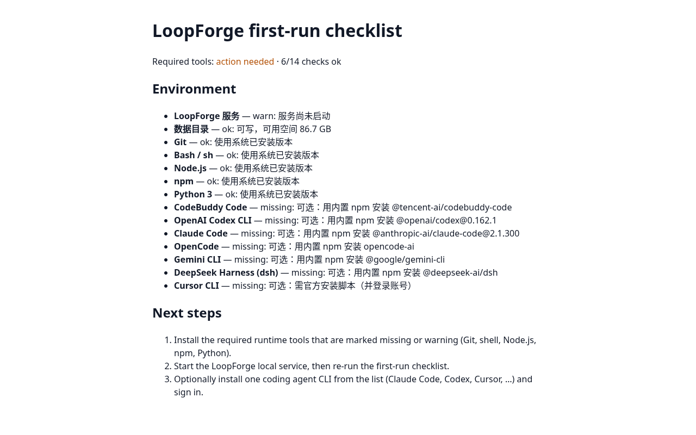
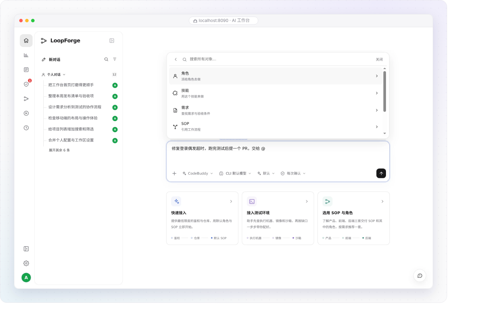

# LoopForge Desktop (Windows x64)

[English](README.md) · [简体中文](README.zh-CN.md)

A one-installer Windows desktop build of [Tencent/LoopForge](https://github.com/Tencent/LoopForge) (MIT). Install it, open it, and start working — **no Docker, no MySQL, no separate runtime setup**.

This is a community desktop package, not an official Tencent release.

[Download LoopForge-Setup-0.3.9.exe](https://github.com/gatesenman/loopforge-desktop/releases/latest)

<p align="center">
  
</p>

## First-run checklist

The desktop shell can write a bundled-runtime status report and a next-steps page from `src/checklist.js`, without building a Windows installer.

```bash
node --test test/envcheck.test.js
```

## What you get

| | Desktop build |
| --- | --- |
| Runtime | Local process + SQLite under `%APPDATA%\LoopForge` |
| Bundled tools | Git for Windows (with bash/sh), Node.js 22 (with npm), Python 3.11 |
| Docker | Not used and not required. The app never starts or probes Docker, so it will not flash black console windows. |
| Coding-agent CLIs | Optional. Install from the environment-check page with the bundled npm, then sign in. |

<p align="center">
  
  <p>First-run runtime checklist generated from the same environment check (Linux; Windows NSIS was not built):</p>
  
</p>

After the first launch, the environment check runs in the same window (not as a second popup). Required tools are marked **Bundled** when the copies inside the installer are used.

<p align="center">
  
</p>

The workbench above is the in-app LoopForge UI (upstream interface) after you create the first admin account.

## Install and first run

1. Download `LoopForge-Setup-0.3.9.exe` from [Releases](https://github.com/gatesenman/loopforge-desktop/releases) and run it (per-user install, Start Menu and desktop shortcuts).
2. The installer is **not code-signed**. Windows SmartScreen may warn you — choose **Run anyway**.
3. On first start, the app boots the local server (about 10–30 seconds while it initializes the database), then shows the environment check in the same window.
4. Create the first administrator account on the login page.
5. Try the built-in sample SOP `welcome-workflow` in the LoopForge experience project — it does not need a model key.
6. To use AI chat or delivery SOPs, install at least one coding-agent CLI from the environment check (CodeBuddy or Codex recommended), sign in or paste a key in settings, then click **Recheck**.

Open **File → Environment check** any time later. Data stays in `%APPDATA%\LoopForge` and is kept on uninstall by default.

## Environment check

| Item | Source | If missing |
| --- | --- | --- |
| LoopForge server, data directory | The app itself | Check the service log; retry start |
| Git, bash/sh, Node.js, npm, Python 3 | **Bundled in the installer** | Reinstall the app. You are not asked to install these with winget. |
| CodeBuddy, Codex, Claude Code, OpenCode, Gemini CLI, dsh | Optional, one-click via bundled npm | Does not block startup |
| Cursor CLI | Optional, official script (account required) | Does not block startup |

The app does not detect, recommend, or install Docker / Docker Desktop / WSL.

## Runtime differences

The only mode is **local execution**. Features that officially need a Docker sandbox are unavailable or reduced: container isolation, image-based reproducible environments, Linux toolchains preinstalled in a sandbox, and anything that must talk to a Docker daemon. Use this build only with trusted repositories and tasks.

## Build from source

This repository holds the Electron / NSIS wrapper. Large runtimes (`vendor-dl/`, `resources/bin/`) are not stored in Git; they are packed into the installer.

```bash
# After you have placed the Windows binaries and portable Git / Node / Python:
npm install
npm run dist
```

The output is `dist/LoopForge-Setup-<version>.exe`.

## License

Upstream LoopForge is MIT. The installer also includes Git for Windows, Node.js, CPython, and Electron/Chromium under their own licenses — see `licenses/` and **Help → Open-source licenses**. This packaging does not change the upstream license.
