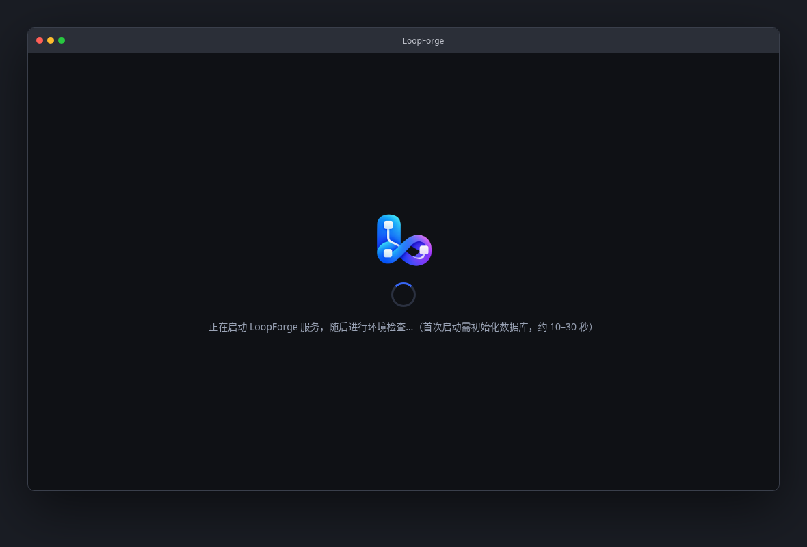
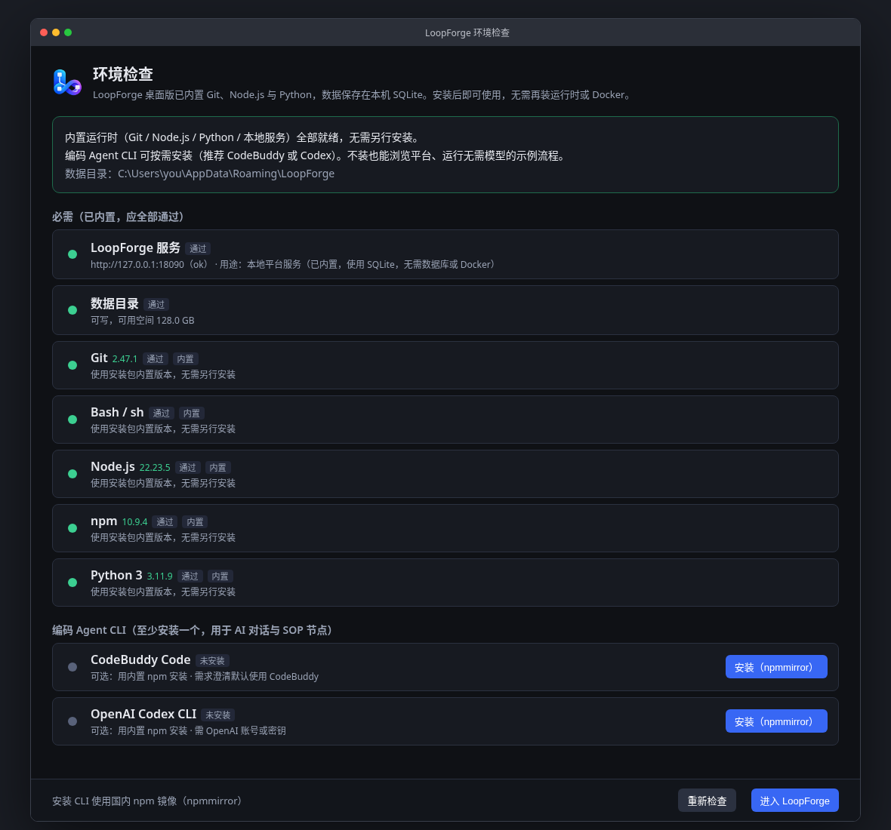
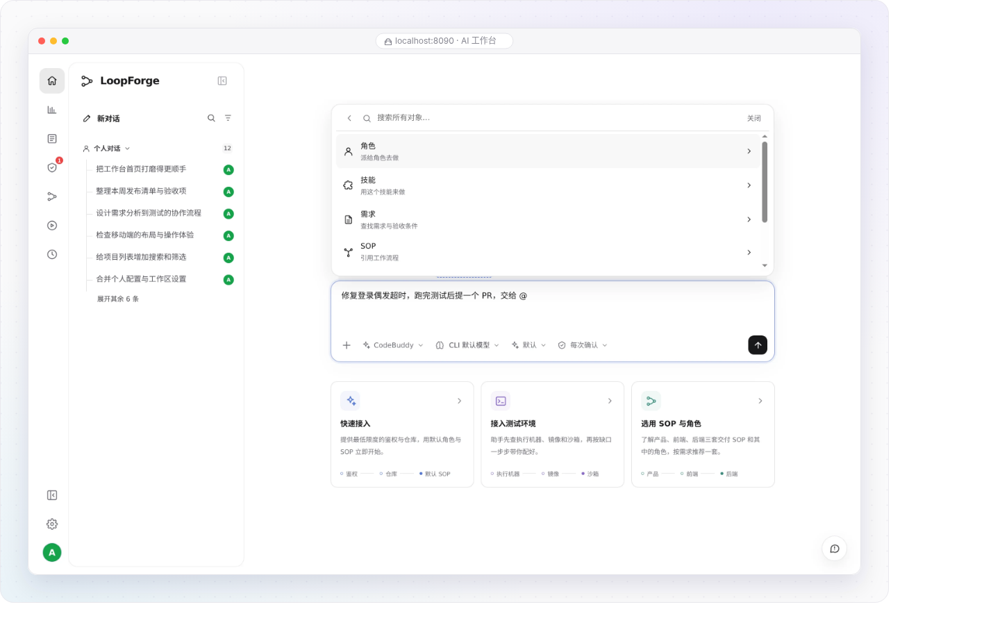

# LoopForge 桌面版（Windows x64）

[English](README.md) · [简体中文](README.zh-CN.md)

将 [Tencent/LoopForge](https://github.com/Tencent/LoopForge)（MIT）打包成 **一个安装包、装完就能用** 的 Windows 桌面应用：**不使用 Docker，不安装 MySQL，也不用再单独装运行环境**。

这是社区桌面封装，不是腾讯官方发布的安装包。

[下载 LoopForge-Setup-0.3.9.exe](https://github.com/gatesenman/loopforge-desktop/releases/latest)

<p align="center">
  
</p>

## 你能直接用到什么

| | 桌面版 |
| --- | --- |
| 运行方式 | 本机进程 + `%APPDATA%\LoopForge` 下的 SQLite |
| 已内置 | Git for Windows（含 bash/sh）、Node.js 22（含 npm）、Python 3.11 |
| Docker | 不使用、不依赖。应用不会启动或探测 Docker，因此不会弹出黑色控制台窗口。 |
| 编码 Agent CLI | 可选。在环境检查页用内置 npm 安装，再到设置里登录。 |

<p align="center">
  
</p>

首次启动时，环境检查会在 **同一个窗口** 里进行，不再额外弹出第二个窗口。使用安装包内的 Git / Node / Python 时，会标记为「内置」。

<p align="center">
  
</p>

上图是创建第一个管理员账号之后，应用内的 LoopForge 工作台（沿用上游界面）。

## 安装与首次使用

1. 从 [Releases](https://github.com/gatesenman/loopforge-desktop/releases) 下载 `LoopForge-Setup-0.3.9.exe` 并运行（当前用户安装，带开始菜单和桌面快捷方式）。
2. 安装包 **没有代码签名**。Windows SmartScreen 可能会提示，选择「仍要运行」即可。
3. 第一次打开会先启动本地服务（初始化数据库大约 10–30 秒），然后在同一窗口进入环境检查。
4. 在登录页创建第一个管理员账号。
5. 可先在「LoopForge 体验项目」里运行无需模型密钥的示例 SOP（`welcome-workflow`）。
6. 若要使用 AI 对话或交付类 SOP：在环境检查里安装至少一个编码 Agent CLI（推荐 CodeBuddy 或 Codex），在个人设置中登录或填写密钥，再点「重新检查」。

之后可随时通过「文件 → 环境检查」打开。数据保存在 `%APPDATA%\LoopForge`，卸载时默认保留。

## 环境检查覆盖范围

| 项目 | 来源 | 缺失时 |
| --- | --- | --- |
| LoopForge 服务、数据目录 | 应用自身 | 查看服务日志，可重试启动 |
| Git、bash/sh、Node.js、npm、Python 3 | **安装包内置** | 请重新安装本应用，不会要求再用 winget 装一份 |
| CodeBuddy / Codex / Claude Code / OpenCode / Gemini CLI / dsh | 可选，用内置 npm 一键安装 | 不阻止启动 |
| Cursor CLI | 可选，官方安装脚本（需账号） | 不阻止启动 |

应用 **不会** 检测、推荐或安装 Docker / Docker Desktop / WSL。

## 运行模式与功能差异

默认且唯一的运行模式是 **本机执行**。上游依赖 Docker 隔离沙箱的能力在此桌面版中不可用或会减弱：容器隔离、基于镜像的可复现环境、沙箱里预装的 Linux 工具链，以及任何必须与 Docker 守护进程通信的功能。请只在受信任的仓库和任务上使用本机执行。

## 从源码打包

本仓库存放 Electron / NSIS 桌面封装源码。体积较大的运行时（`vendor-dl/`、`resources/bin/`）不放入 Git，而是打进安装包。

```bash
# 准备好 Windows 平台程序以及便携版 Git / Node / Python 后：
npm install
npm run dist
```

生成文件为 `dist/LoopForge-Setup-<version>.exe`。

## 许可

上游 LoopForge 为 MIT。安装包还包含 Git for Windows、Node.js、CPython 以及 Electron/Chromium 的各自许可，详见 `licenses/` 与程序内「帮助 → 开源许可与第三方声明」。本桌面封装未改变上游许可证。
